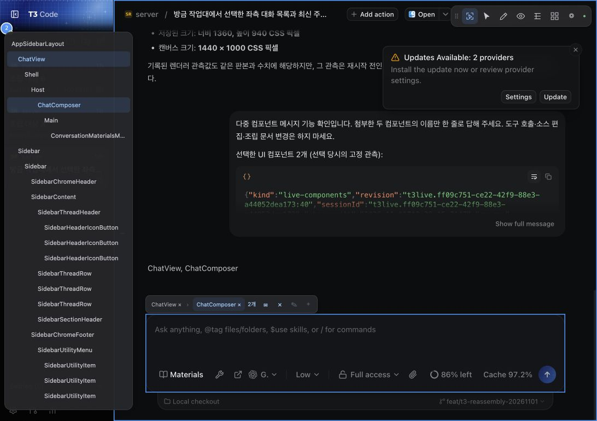

# t3module

AI와 코딩하다 보면 이미 설명한 내용을 새 대화에서 다시 설명하고, 수정할 화면의 위치를 긴 문장으로 알려줘야 했습니다. 기존 코딩 도구 T3를 바탕으로 필요한 자료와 화면 부분을 직접 골라 AI와 공유하는 기능을 개발하고 있습니다.

## 코드

- [Codex 실행기 확장](modules/conversation-execution/native/codex): 활성 맥락 조회와 대화 복원, 실행 정책을 수정한 OpenAI Codex 포크입니다. [수정 파일과 기준 판본](UPSTREAM.json)을 함께 보존했습니다.
- [계보 UI](modules/lineage-ui): 대화 가족 정렬과 React 표시 구성요소입니다.
- [UI 관측 도구](tools/ui-observation): 화면·구조·조작 기록을 수집하고 조회·비교하는 TypeScript 라이브러리와 CLI입니다.

이 저장소는 t3module 폴더의 코드 공개본입니다. 실행 화면의 T3 호스트 앱과 별도 작업대 앱은 독립적으로 개발하고 연결합니다.

## 대화와 실행 화면



[대화 캡처 4장과 설명](examples/captures/README.md)에서 자연어 배치 변경, 화면 선택, 도구 선택, 재시작 후 대화 재개를 볼 수 있습니다.

## 검사와 실행

Node.js 24 이상에서 순수 계보 정렬과 소스 경계를 검사합니다.

```sh
npm test
npm run check:boundaries
```

UI 관측 도구:

```sh
cd tools/ui-observation
npm ci
npm test
node dist/cli.js --help
```

네이티브 실행기 빌드는 해당 폴더의 upstream README를 따릅니다. 실제 데스크톱 관측에는 연결 대상과 명시적인 접근 권한이 필요합니다.

## 공개 범위와 라이선스

설계 문서, 설계 검사 전용 도구·상태 기록, Git 이력, 설치한 의존성과 빌드 산출물은 포함하지 않았습니다. 설명 자료로 T3 대화 캡처를 포함했습니다.

프로젝트 라이선스는 [Apache-2.0](LICENSE)입니다. 재사용한 구성요소의 저작권·라이선스 고지는 [NOTICE](NOTICE)와 각 구성요소의 라이선스 파일에 보존했습니다.
