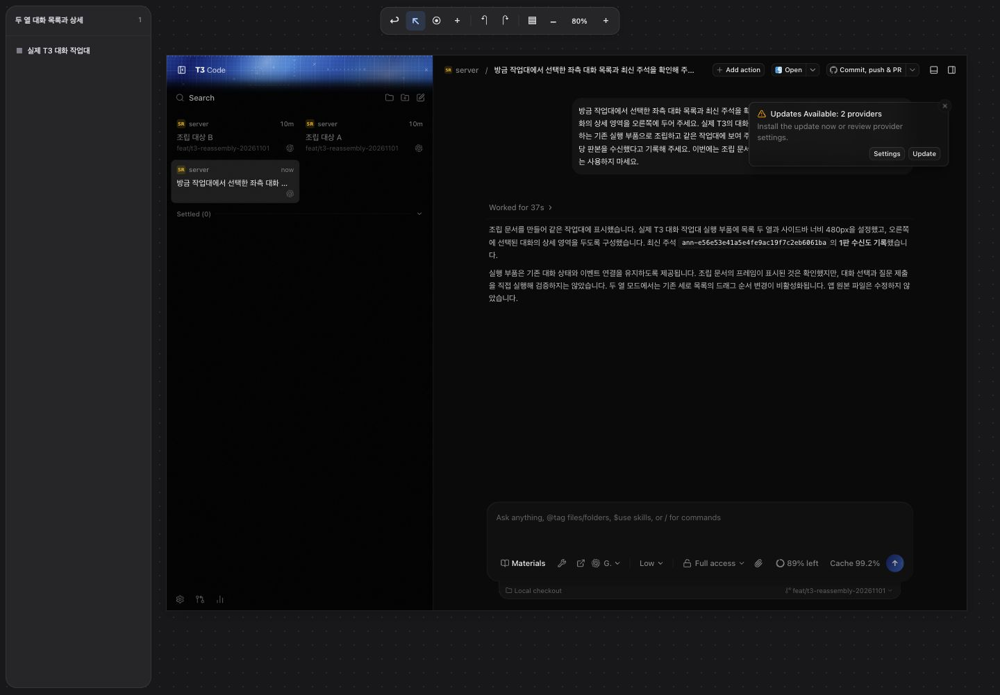
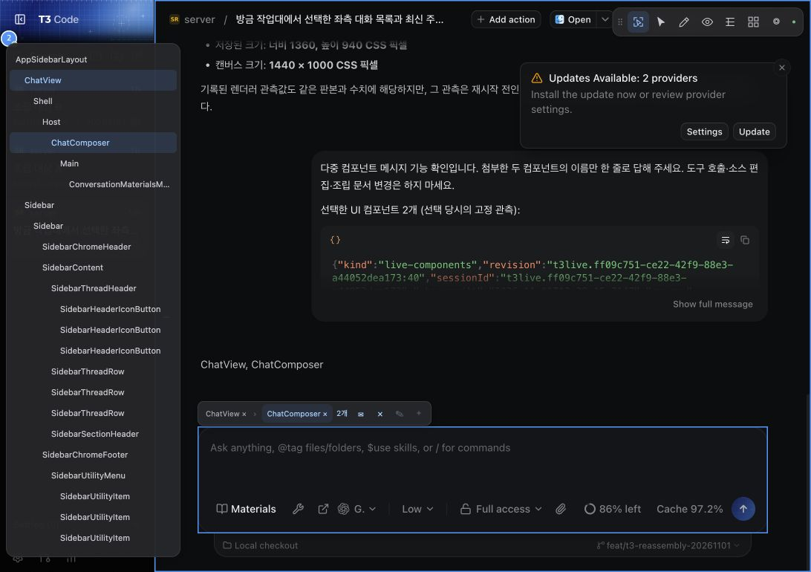
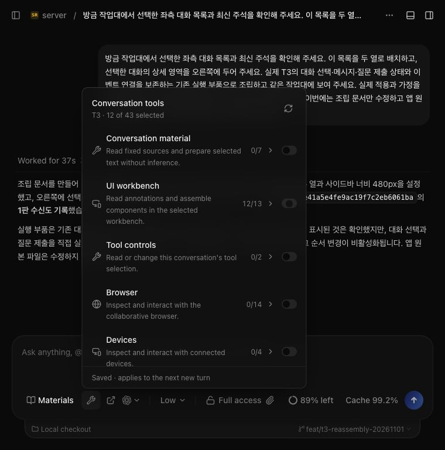
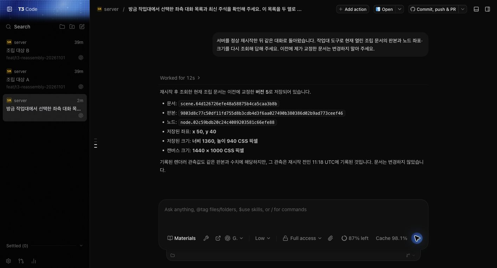

# T3 대화와 실행 캡처

별도 T3 호스트와 작업대에 모듈을 연결해 개발 중인 실제 화면입니다. 캡처를 수정하거나 다시 그리지 않았습니다.

## 자연어 요청으로 대화 목록을 두 열로 재배치한 작업대

## 화면 요소 두 개를 선택해 전달하고 모델이 두 이름을 응답한 대화

## 같은 대화에서 다음 턴에 사용할 도구를 선택하는 화면

## 서버 재시작 뒤 저장한 작업대 결과를 같은 대화에서 다시 조회한 화면

